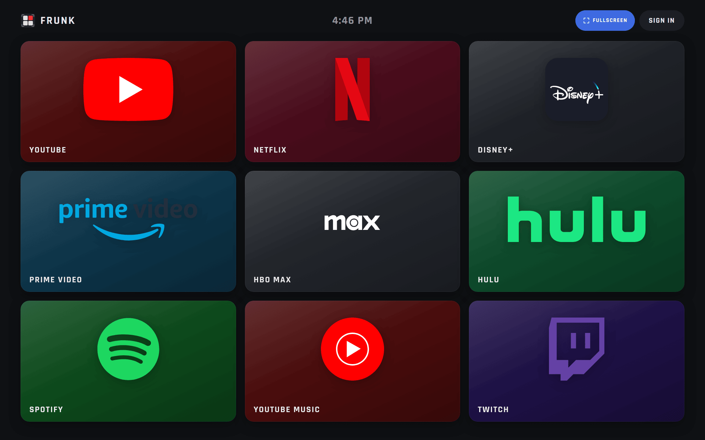
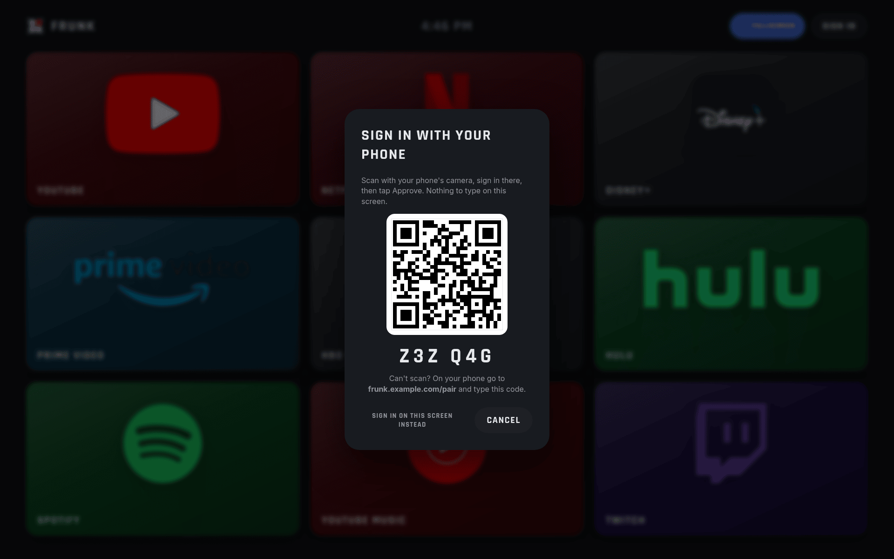
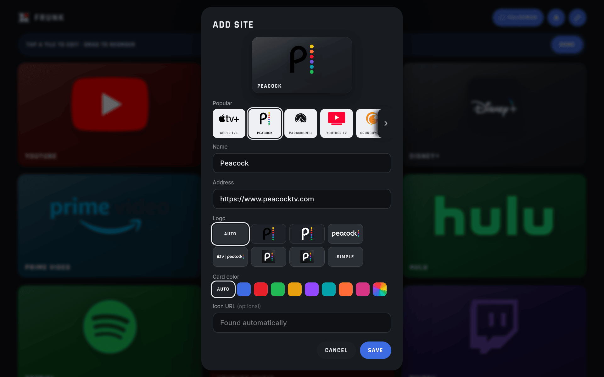

<h1 align="center">
  
</h1>

<p align="center">
  <a href="https://github.com/jbuxxy/frunk/actions/workflows/test.yml"></a>
  <a href="https://github.com/jbuxxy/frunk/releases"></a>
  <a href="https://github.com/jbuxxy/frunk/pkgs/container/frunk"></a>
  <a href="LICENSE"></a>
</p>

A big-button, fullscreen site launcher for the Tesla in-car browser.

Frunk gives the car's browser a home screen of large, Theater-style tiles for the
sites you use: streaming services, music, your own self-hosted apps. It also gets
the browser into fullscreen with one tap.



<table>
  <tr>
    <td></td>
    <td></td>
  </tr>
  <tr>
    <td align="center">Sign in with your phone</td>
    <td align="center">Add a tile</td>
  </tr>
</table>

<sub>Screenshots at 1920×1200, the resolution of the Model 3 and Model Y center screen.</sub>

- **Fullscreen.** Tesla's browser goes fullscreen on youtube.com and stays that way
  after you leave. The first time you tap a video tile in the car (YouTube, Netflix,
  Disney+ and the like), Frunk offers to route you through `youtube.com/redirect`.
  You tap "Go to site" once, land back on Frunk in fullscreen, and the tile you
  picked opens. The browser's back button returns to Frunk. Whether a tile asks is
  its **Ask to go fullscreen first** setting: on for video services, off for
  everything else (an FSP tile plays in the page and doesn't need it).
- **Rear screen.** Because the car treats that session as the YouTube Theater app,
  cars with a rear display offer **Join Front Display**. Rear passengers can keep
  watching after the car shifts out of Park. A Watch Party doesn't need fullscreen:
  its **Fullscreen** button goes there (and back into the party) when you want the
  rear screen to join, or to watch fullscreen while parked.
- **Tiles.** Logos and colors are filled in automatically from
  [Dashboard Icons](https://github.com/homarr-labs/dashboard-icons) and
  [Simple Icons](https://simpleicons.org). You can also pick another logo or color.
  Hold a tile for its menu; in edit mode, hold and drag to reorder. An admin can
  send a tile to other people: it lands at the end of their page, with a notice on
  their screen (at once if Frunk is open, otherwise at their next visit).
- **Your own color.** Each person picks the color of their profile circle by
  tapping it in their account menu.
- **Accounts.** Invite-only. People sign in with Google or a password, and each
  person has their own page. Signed-out visitors see a default page that the admin
  edits.
- **Sign in with your phone.** The car shows a QR code, you approve it on your
  phone, and the car is signed in. There's no typing on the car's screen.
- **Watch Party.** Watch together from different cars (or phones): one person
  hosts, everyone else sees a **Join** button, and playback stays in step on
  every screen, with a chat, emoji and one-tap reactions that float over the
  video. The host picks who else may play, pause and skip. Hosts play from
  their own Plex or Audiobookshelf account (connected under **Connected apps**
  in the account menu; the Watch Party button offers to connect one if you
  haven't); guests need nothing but Frunk. Everyone watches one Plex transcode,
  so the server does the work once. Admins also get a test video.
  **Talk:** hold the Talk button to speak to everyone, like a walkie-talkie; one
  person at a time, and the video dips while someone talks. The host picks who may
  talk. (Tesla turns the microphone off in fullscreen.)
  The host chooses who can join (people with an account right away or after
  asking; people without one not at all, after asking, or right away, as a
  guest of that one party) and can remove anyone. A guest who closes the page and
  comes back rejoins as the same guest. New chat messages chime and show a banner
  while the party is minimized.
- **No dependencies.** A single Node.js server with no npm packages, and a
  vanilla JS front end.

## Quick start

```sh
cp .env.example .env        # set FRUNK_OWNER_EMAIL at least
docker compose up -d --build
docker compose logs frunk   # prints a one-time link to set the admin password
```

Open the link from the log, choose a password, and you're the admin. Put Frunk
behind HTTPS (any reverse proxy) before using it from the car.

To skip the build, use the published image instead: every push to `main` that
passes the tests is published as `ghcr.io/jbuxxy/frunk:latest`. In
`docker-compose.yml`, replace the `build: .` and `image: frunk:local` lines with
`image: ghcr.io/jbuxxy/frunk:latest`, then run `docker compose up -d`.

## Configuration

All settings are environment variables. Only `FRUNK_OWNER_EMAIL` is required.

| Variable | Purpose |
| --- | --- |
| `FRUNK_OWNER_EMAIL` | The admin account. On first start it gets the default tiles and a password-setup link in the log. |
| `FRUNK_PUBLIC_URL` | Public address, e.g. `https://frunk.example.com`. Used in invite, pairing and Google links. **Set this in production.** |
| `TRUSTED_PROXIES` | Reverse-proxy IPs or CIDRs (comma-separated) whose `X-Real-IP` / `X-Forwarded-*` headers are trusted. Default `127.0.0.1,::1`. Without it, the login lockout sees only your proxy's address. |
| `GOOGLE_CLIENT_ID`, `GOOGLE_CLIENT_SECRET` | Optional Google sign-in. See [Google sign-in](docs/google-sign-in.md). |
| `SMTP_HOST`, `SMTP_PORT`, `SMTP_USER`, `SMTP_PASSWORD`, `SMTP_FROM` | Email invites. Port 465 uses implicit TLS; anything else uses STARTTLS. Without SMTP, invite links are copied for you to send. |
| `PLEX_URL` | Your Plex server, e.g. `https://plex.example.com`, for the Watch Party. People connect by entering a code at plex.tv/link; Frunk keeps a token for this server only. |
| `ABS_URL` | Your Audiobookshelf server, e.g. `https://abs.example.com`, for the Watch Party. People connect their own account to it with an API key; Frunk only ever talks to this address. |
| `FSP_URL`, `FSP_SECRET` | Optional: an FSP (Front Seat Plex) server on your LAN and its partner secret. In the Tesla, Plex parties then play on a canvas the car doesn't pause while driving, one shared stream per party (H.264 from FSP's iGPU at 720p on newer cars and 480p on older ones, picked by the car's model; MPEG-1 only for a car without an H.264 decoder; a car that keeps running out of sound is offered a lower quality, never switched by itself). Without it the car uses the normal player, which Drive pauses. |
| `FSP_PUBLIC_URL` | Optional: FSP's public address, e.g. `https://fsp.example.com`. Party cars then stream straight from FSP (with a one-time ticket Frunk gets for them), so Frunk passes no video on; without it, Frunk relays each car's stream. And an FSP tile counts as Plex in a Watch Party: badged, and it opens the Plex picker. In the car, tapping a Plex tile offers to open FSP instead (Plex's own player stops when the car moves), with an option to remember the choice. |
| `PORT`, `DATA_DIR` | Listen port (default `3000`; `0` picks a free one) and data folder (default `./data`, `/data` in Docker). |
| `SIMPLE_ICONS_URL`, `DASHBOARD_ICONS_URL` | Where the logo lists and SVGs come from. Defaults to jsDelivr; set these to use a mirror. |

## Development

Frunk needs Node.js 22 or later. Running it needs no `npm install`; only the
browser test has a dependency.

```sh
npm run dev           # node --watch server.js, on http://localhost:3000
npm test              # unit + API tests (node:test), no network needed
npm run check         # syntax check of every source file
npm install && npm run test:browser   # the real page in headless Chrome
```

The API tests in `test/server.test.js` start the real server on a free port with
a throwaway data folder, and a fake logo CDN and website on localhost
(`test/helpers.js`). The browser test walks the main screens and fails on any
script error or broken dialog; it looks for Chrome at `CHROME_PATH` and skips
itself without it. GitHub Actions runs all of it, plus a Docker build, on every
push and pull request.

To preview the car-only UI on a desktop, override the browser's user agent with
one containing `Tesla` (Chrome DevTools → Network conditions).

### Layout

| File | What it does |
| --- | --- |
| `server.js` | HTTP server: static files, JSON API, Google sign-in, phone pairing, icon and logo lookup |
| `accounts.js` | Users, invites and sessions, stored in `DATA_DIR/accounts.json` |
| `party.js` | Watch Party rooms: members, what's playing and where, who may control it (in memory) |
| `apps.js` | Apps a Watch Party plays from (Plex, Audiobookshelf), on the servers named in the environment, and the stream proxy |
| `fetcher.js` | Outbound fetches for user-supplied URLs, with private-network blocking |
| `mailer.js` | Minimal SMTP client for invite emails |
| `public/` | The launcher page (`index.html`, `app.js`, `style.css`) |
| `public/vendor/qrcode.min.js` | [qrcode-generator](https://github.com/kazuhikoarase/qrcode-generator) 1.4.4, MIT |
| `public/party.js` | Watch Party: Host and Join, the party screen, playback kept in step |
| `public/vendor/hls.min.js` | [hls.js](https://github.com/video-dev/hls.js) 1.5.17, Apache-2.0 |
| `public/car.js` | Watch Party in the Tesla: Plex parties on a canvas (via FSP), in step with the party |
| `public/vendor/jsmpeg.min.js` | [jsmpeg-player](https://github.com/cycjimmy/jsmpeg-player) 6.1.2 (JSMpeg), MIT |
| `public/h264.js`, `public/h264-worker.js` | H.264 for the car player: a JSMpeg video decoder using WebCodecs or tinyh264 (shared with FSP) |
| `public/vendor/tinyh264/` | [tinyh264](https://github.com/udevbe/tinyh264) 0.0.7 (WebAssembly H.264 decoder, from h264bsd), Apache-2.0 |
| `public/vendor/twemoji/` | Chat emoji from [Twemoji](https://github.com/jdecked/twemoji) 15.1.0, graphics CC-BY 4.0 |
| `public/fonts/` | Inter and Rajdhani (Latin subset), SIL Open Font License |
| `test/` | Unit, API and browser tests |

## Security notes

**Passwords and sessions**
- Passwords are hashed with scrypt (N=2^14, r=8, p=5) and a per-user salt.
  Older hashes are upgraded at the next sign-in.
- Session tokens are random, and only their SHA-256 hashes are stored. The cookie
  is `HttpOnly`, `SameSite=Lax`, and `Secure` behind HTTPS.
- Password sign-in is rate-limited per client IP.

**Google sign-in**
- Google tokens are verified before anyone is signed in, and only invited
  people can create an account.

**Requests and responses**
- Every state-changing API call must be a JSON request, which blocks cross-site
  form posts.
- Pages are served with a strict Content Security Policy.
- Fetched images are served with a sandboxing CSP, so an SVG can't run script on
  Frunk's origin.

**Fetching from your network**
- Only admins' tiles (and the default page) may fetch icons from private or local
  addresses. Other users can't use Frunk to reach the server's network.
- One exception, for everyone: a public HTTPS site that your own DNS sends to a
  LAN address (split DNS, e.g. your reverse proxy). If public DNS gives the name
  only public addresses, its icon is fetched over the LAN route, and its
  certificate must match the name, which a device on your network can't fake for
  someone else's domain. Plain HTTP to such a name is refused.

**Watch Party**
- Connected apps only talk to the servers named in the environment, so a key
  can't be used to make Frunk fetch from anywhere else. Keys are kept with the
  account on the server and never sent back to a browser.
- Guests stream what the host plays through Frunk, and only while they're in
  that party; each new choice gets new addresses.
- The car player's stream is asked for from FSP with the host's key and a shared
  secret over your LAN; neither reaches a browser. With `FSP_PUBLIC_URL` set, the
  car gets a ticket for its stream instead: random, single use, valid for a
  minute, and good for that one stream only.
- A guest without an account gets a pass (an HttpOnly cookie) for that one
  party: it reaches the party's own routes and nothing else, can't choose what
  plays, and stops working when the party ends or the host removes them. Guest
  joins and code lookups are rate-limited per IP.

**Admin powers**
- The admin can reset any member's password, because a reset is an invite link
  the admin can see.

## License

[MIT](LICENSE)
